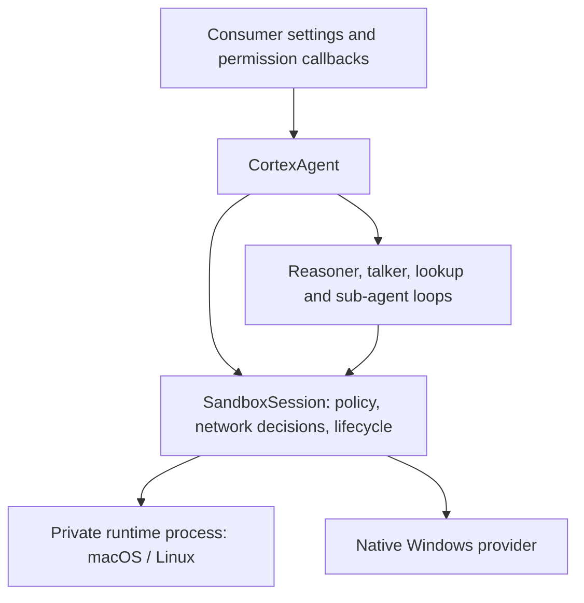

# Sandboxing

Cortex owns sandboxing as an opt-in framework capability. All policy and platform implementation code ships in `@animus-labs/cortex`. Consumers choose whether to enable it and supply settings; they do not construct a backend for ordinary use. See the [consumer guide](./sandbox-consumer-guide.md) for configuration.

## Ownership

`CortexAgent.create()` resolves sandbox settings before creating its loops. A managed session creates the default policy and private temporary directory, initializes the platform backend, and checks enforcement. All resident loops, sub-agents, and framework-owned stdio MCP processes borrow that same session. Loops never dispose it. The facade shuts down its loops and owned MCP connections before disposing the sandbox and removing the temporary directory. Failed creation also cleans up.

The framework defaults to sandboxing disabled. `sandbox: true` enables workspace containment with strict enforcement. An object can select a rung and override settings. No extra setup callbacks are required.

## Why the package boundary changed

The July 2026 design intentionally put enforcement in a separate package to keep Cortex's dependencies small and make the backend replaceable. It placed backend initialization, policy construction, temporary-directory creation, network wiring, and cleanup in consumers.

That separated a framework capability from the framework that needed to own its lifetime. It also made Cortex Code responsible for mandatory in-process file protections that any consumer needs. The revised design keeps replaceable platform modules and the `SandboxProvider` contract inside Cortex, while making the framework own the complete default setup. The runtime dependency is pinned and isolated behind the provider interface. Consumers no longer install a sandbox package.

## Module boundaries

| Module | Responsibility |
| --- | --- |
| `sandbox/options.ts` | Public opt-in settings and validation. |
| `sandbox/session.ts` | Policy, temporary directory, enforcement checks, status, and owned backend lifetime. |
| `sandbox/policy.ts` | Trust presets, protected paths, domain matching, credential names. |
| `sandbox/file-policy.ts` | In-process built-in tool path boundary, including symlink resolution. |
| `sandbox/network-policy.ts` | Shared network policy and session grants. |
| `sandbox/factory.ts` | Platform selection. |
| `sandbox/backends/runtime-process.ts` | Private macOS/Linux worker lifecycle and IPC. |
| `sandbox/backends/runtime-worker.ts` | Worker-side runtime adapter. |
| `sandbox/backends/runtime.ts` | Translation to pinned sandbox-runtime and OS wrapper generation. |
| `sandbox/backends/windows.ts` | Native Windows helper integration and status. |
| `sandbox/classify.ts` | Structured denial diagnostics. |

Platform modules never depend on Cortex Code. The facade has a thin lifecycle integration, and AgentLoop borrows the provider contract. The native helper source and future bundled artifacts live under `packages/cortex/windows-helper` and `packages/cortex/vendor`.

## Policy and approval

Containment limits what an executing command can access. Permission callbacks decide when a human must approve an operation. Approving a built-in file tool does not bypass its sandbox policy. A single-command Bash escalation is separately authorized and does not change the session policy.

| Rung | Filesystem policy | Network policy |
| --- | --- | --- |
| `restricted` | No workspace writes; secret reads denied. | No egress. |
| `workspace` | Write workspace roots and private temp; secrets and dangerous configuration protected. | Seeded registries, configured allowlist, optional host decisions. |
| `trusted` | Same filesystem boundary as workspace. | Open HTTP/S through the proxy, subject to explicit denials. |
| `off` | No sandbox boundary. | No sandbox gate. |

The runtime has narrow OS-required writable exceptions even in restricted mode; it is not a claim that every byte on the filesystem is read-only. Roots come from trusted configuration and cannot widen when a tool changes its working directory. Consumers add their own settings and secrets to the built-in deny lists.

Policy changes belong to trusted host code. `setSandboxRung()` requires settled agent work, rejects concurrent changes, and blocks new tool execution during a transition. Connected stdio MCP servers must be disconnected before a policy change and reconnected afterward so they launch under the new OS profile. Consumers own persistence and the decision to expose policy changes to users.

## Platform enforcement

On macOS and Linux, Cortex uses pinned `@anthropic-ai/sandbox-runtime` 0.0.79. It generates Seatbelt profiles on macOS and bubblewrap/seccomp wrappers on Linux, with a proxy for domain-controlled network access. Linux requires working `bubblewrap`, `socat`, and `rg` on `PATH` (the runtime's dependency check refuses without ripgrep); available binaries alone do not prove that user namespaces are usable. The runtime also offers proxy-side credential masking (secrets replaced by sentinels in the child and substituted back at the TLS-terminating proxy); Cortex does not use it yet and scrubs credential environment variables instead. Upstream accepts a `:port` suffix on domain entries, but Cortex's in-process matcher (used by WebFetch) does not, so a port-scoped entry allows shell traffic on that port while WebFetch treats it as unmatched (falling through to `resolveNetworkAccess`, else deny).

The upstream runtime owns process-global policy, proxy state, and temporary-directory environment. Each managed root agent therefore gets a private worker process. Two agents can use different roots and policies without overwriting each other's runtime state. Disposing one agent leaves the other agent's backend active. The host environment is not modified.

Native Windows uses Cortex's restricted-token helper. Tier 1 confines writes and scrubs credential environment variables, but does not enforce secret-file read denial or network restrictions. It reports filesystem `partial` and network `none`. A missing or unusable helper reports `none`. Signed helper distribution and stronger Windows containment remain separate work; see [the build runbook](./windows-sandbox-build.md).

`SandboxStatus` reports actual enforcement. Managed setup requires all requested dimensions by default and refuses unavailable or partial enforcement. `requireEnforcement: false` explicitly permits degraded operation. Cortex Code chooses that fallback explicitly to retain its existing behavior and displays the result; this is a consumer preference, not a framework default.

## Windows backend: MXC BaseContainer (design)

Native Windows moves to Microsoft eXecution Containers (MXC 1.0.0, `@microsoft/mxc-sdk`), following the approach of Codex's `codex-rs/mxc-sandbox`. Only the BaseContainer tier is used. It is enforced by the OS through the process security environment (PSEC, `CreateProcessSecurityEnvironment`), needs no elevation, and makes no host ACL changes. The AppContainer tiers (`appcontainer-bfs`, `appcontainer-dacl`) are never accepted. They are weaker and the DACL tier edits host ACLs. The restricted-token helper is removed rather than kept as a fallback.

**Provider shape.** Three modules under `sandbox/backends/`:

| Module | Responsibility |
| --- | --- |
| `mxc.ts` | `MxcSandboxProvider`: probe, host-side proxy, per-command request, status, lifecycle. Runs in the agent process and never loads the SDK. |
| `mxc-request.ts` | Pure mapping from `SandboxPolicy` to an MXC `ContainerRequest`, Windows command-line quoting, and the launcher's env transport. |
| `mxc-launcher.ts` | Per-command launcher process. It is the only code that imports the SDK. Self-contained: Node builtins and the SDK only. |

**Contract fit: a launcher process, not a contract change.** MXC's SDK owns the spawn. `spawn(request)` creates the contained process in-process through `mxc_ffi.dll` and returns an `MxcProcess` with Node streams. `wrapSpawn` and `wrapExec` return `{file, args, env}`, and four call sites depend on that shape: Bash, Grep, skill shell markers, and stdio MCP. The MCP SDK's stdio transport spawns from a command and argument list itself and cannot adopt a process someone else started. Changing the contract would touch all four and need a custom MCP transport. So the provider returns `{ file: process.execPath, args: [launcher, '--run'], env }` instead. As in Codex, the request travels in launcher-only environment chunks so the command keeps Windows' command-line budget. The launcher strips those chunks, re-runs the tier gate, calls `spawn`, pipes stdin, stdout, and stderr both ways, and exits with the workload's exit code. If the gate or spawn fails, it prints `cortex-mxc-launcher:` and a reason, exits 125, and never runs the command uncontained.

The cost is one extra Node process per command (startup plus SDK load). In return the contract stays the same, and koffi plus the native payload never load into the agent process. Kill semantics also carry over: killing the launcher closes MXC's kill-on-close job, which takes down the container's process tree. Calling `bin/<arch>/wxc-exec.exe --config-base64` directly would skip the Node hop and could set `fallback.allowDaclMutation: false`. It was rejected because `wxc-exec` is not part of the SDK's versioned API.

**Policy mapping.** MXC allowlists reads, while Cortex's policy reads everything except secrets. The mapping follows Codex:

- `readwritePaths`: the policy's writable roots (workspace roots and the session temp).
- `readonlyPaths`, the read set:
  - every logical volume root, plus a snapshot of each root's immediate children (volume-root grants do not recurse);
  - the Windows directory, Program Files, Program Files (x86), and ProgramData.

  The snapshot is taken at initialize. An entry created directly under a volume root afterwards is not readable until the next policy change.
- Read-only carve-outs inside writable roots: `denyWrite` entries (`.git/hooks`, `.git/config`, consumer config) and the host-side code the launcher runs (the launcher, the SDK and its dependencies, `node.exe`). The second group matters when a workspace contains Cortex itself. Missing carve-outs stay in the request so creating them should also be refused (unverified on PSEC; see the checklist).
- `deniedPaths`: the `denyRead` entries that exist when the command is wrapped. PSEC enforces these natively (`PSE_SUPPORT_FS_DENY`). `allowRead` entries become `readonlyPaths`.
- Environment: credential variables are scrubbed, `TEMP`/`TMP` point at the session temp, and the environment is passed verbatim. MXC requires `SystemRoot` and `LOCALAPPDATA` in it.
- UI: `ui.disable: false`, no clipboard, no input injection, and BaseProcess UI isolation `desktop`. Codex found PowerShell needs Win32k and desktop handles at startup.

**Network.** This follows Codex's shape rather than MXC's `runtimeConfig.networkProxy` mode:

- Allowlist and full modes:
  - egress defaults to deny, with one allow rule for `127.0.0.0/8` and `::1/128` on all ports;
  - ingress defaults to deny, and `hostLoopback` is `allow`.

  A host-side HTTP proxy applies the same domain policy and resolver as macOS and Linux. It is the pinned sandbox-runtime's proxy server, deep-imported. `HTTP(S)_PROXY` and friends point at it. A client that ignores proxy variables cannot connect, so it fails rather than bypassing the policy.
- Deny mode: egress is denied. Loopback follows `allowLocalBinding`.
- The `hostLoopback` tradeoff: PSEC host loopback is bidirectional and covers every loopback port. A contained command can reach any service listening on host loopback, such as dev servers, local databases, or a Docker TCP socket, which matches `allowLocalBinding` on macOS and Linux. Narrowing this to the proxy alone needs MXC's identity-scoped `allowedProxyPeer`, which needs a packaged proxy identity. MXC's `networkProxy` mode with an unpackaged proxy also needs `hostLoopback: allow`, so it gains nothing here.
- `allowLocalBinding: false` combined with allowlist or full egress cannot reach the proxy, so all egress is denied. That is stricter than requested and reported as a degradation.
- The host-side proxy has no SOCKS listener. It also lacks the resolved-address guard that the runtime applies inside its own manager.

**Probe and status.** `initialize()` runs the launcher in `--probe` mode against the real request shape. Each of these must hold:

- Node is 24.21 or later in the 24 line, or 26.8 or later (MXC's native stdio transfer).
- The SDK imports.
- `getAvailableBackends()` lists `processcontainer` at tier `base-container`, with `filesystemDeniedPaths` when deny paths exist and `ingressHostLoopbackAllow` when loopback is allowed.
- `probe(request)` selects `base-container` without DACL augmentation.

`getPlatformSupport()` is not used. It is always true on win32, and it runs `dism` and `wxc-exec --probe`, which can restore leftover DACLs. The launcher repeats the backend and `probe(request)` gate before every spawn. The requests Cortex builds for networked rungs (explicit egress rules, `hostLoopback: allow`) cannot fall back to an AppContainer tier anyway; MXC rejects them with a typed error. If the probe passes, status is filesystem and network `enforced` with backend `mxc-base-container`. Any failure reports `none` with the reason (for example a missing SDK, an OS build without PSEC, or a missing capability). There is no fallback to another backend and no partial mode.

**Factory selection.** On win32, `createSandboxProvider` returns the MXC provider. If its probe passes, commands are contained. Otherwise status is `none` with the reason, and strict managed setup refuses. MXC needs Windows 11 24H2 or 25H2 at build `.9278` or later (KB5120998), or 26H1/26H2. The build number is never compared: KB5120998 rolls MXC out gradually and Windows Server has a different revision line, so only the runtime probe decides.

**Dependency strategy.** `@microsoft/mxc-sdk` is about 105 MB unpacked and declares no `os` or `cpu`. It depends on koffi and node-pty (another 64 MB, with a node-gyp fallback) and imports koffi at module load. As an `optionalDependency` it would install on macOS and Linux too, so it is an optional peer dependency instead. Only the launcher loads it, through a dynamic import. Windows consumers install it next to Cortex. Its Windows binaries carry Microsoft Authenticode signatures, and Cortex ships no native binary of its own.

**Child-process lifetime.** MXC kills remaining descendants when the foreground process exits. Cortex's background Bash tasks keep the launcher alive, so they keep working. A detached server started inside a foreground command (`Start-Process`, `start`) dies when that command returns. This differs from macOS and Linux. Cortex pipes stdio and does not use MXC's PTY mode.

**Cortex Code default.** Windows stays opt-in (`off`) until the validation checklist in the [Windows runbook](./windows-sandbox-build.md) passes on a real Windows 11 host. The old reason for opt-in, an unsigned helper that antivirus flags, no longer applies. After validation the proposed default is `workspace` whenever the MXC probe passes.

**CI.** GitHub's `windows-latest` is Windows Server 2025. MXC documents Windows 11 only, and MXC's own hosted-runner jobs skip real sandbox tests. Real containment needs a self-hosted Windows 11 runner. The `windows-11-arm` hosted image (build 26200.9457) is a candidate, but whether PSEC is enabled there is unverified.

## Network flow

Cortex checks explicit denied domains first. Restricted policy denies every host. Workspace policy permits seeded registries and configured domains; unknown hosts reach the optional `resolveNetworkAccess` callback and otherwise are denied. Session grants cover shell traffic and WebFetch. Trusted policy allows network traffic subject to explicit deny rules.

The managed session automatically wires shell requests through the same resolver as WebFetch. In duplex mode this includes the permission broker, so a callback returning `ask` reaches the conversation. A consumer adopting managed setup does not call `getNetworkAccessResolver()` to finish construction.

## Coverage and limits

Bash, Grep, skill shell markers (`` !`cmd` ``), and framework-owned stdio MCP subprocesses use the shared provider. Built-in file tools receive path checks before execution, even without a consumer permission callback. Symlink targets and not-yet-existing paths are resolved through their existing ancestors. These checks supplement the OS boundary; in-process checks are not a filesystem isolation mechanism for the entire Node process.

Custom tools, skill script markers (`!{script: ...}`, which run in-process), direct consumer subprocesses, remote MCP servers, and host-side network clients do not become contained merely because the agent has a sandbox. Custom tools must honor policy or use an isolated execution path. Glob checks its requested search root; it does not hide every denied descendant name from directory listings. Read denial applies when contents are opened by the built-in Read tool or the OS-contained subprocess.

macOS/Linux network control is proxy-oriented, so arbitrary raw socket protocols are not a general supported egress interface. Loopback access and OS-required paths retain the backend's documented exceptions. Windows Tier 1 has the larger limitations described above.

Tests cover policy, denials, credential scrubbing, managed cleanup and transitions, in-process file gates, platform adapters, and real macOS containment. The two-root integration test proves simultaneous worker isolation and surviving-agent operation after teardown. Native Windows containment tests require a Windows host and helper.
